<div align="center">

<h1>ReplyBond</h1>

<p><strong>Pay an API per call. If it never answers, you get your price back plus the provider's bond, on Arc, in USDC.</strong></p>



[](https://replybond.edycu.dev)
[](https://dorahacks.io/hackathon/arc-microgrants-2/detail)

[](https://explorer.arc.io/address/0x2a0f4aeF8E5379d8E4606F40846cf97716fe749f)
[](contracts/ReplyBond.sol)
[](foundry.toml)
[](tsconfig.json)
[](package.json)
[](vite.config.ts)
[](package.json)
[](LICENSE)
[](https://github.com/edycutjong/replybond/actions/workflows/ci.yml)

**Live:** https://replybond.edycu.dev · Arc mainnet (chain 5042, native USDC)

**Contract:** [`0x2a0f4aeF8E5379d8E4606F40846cf97716fe749f`](https://explorer.arc.io/address/0x2a0f4aeF8E5379d8E4606F40846cf97716fe749f) · Sourcify exact match

**Example settlement (timeout):** [`0x7312e5db…3a77`](https://explorer.arc.io/tx/0x7312e5db712a360e5b582e0f0afa0a9b96e4ce228d89036d6fcd5aae26783a77) · 0.015 USDC back to the buyer

**Built in Arc Studio:** https://studio.arc.io/app/aaea9afa-1278-4d24-8918-87e8ba733ca4 (opens with an Arc Studio login)

**Tests:** `forge test` with the pinned forge 1.7.1 (`.foundry-version`): 66 passed, 0 failed (63 unit and fuzz tests plus 3 invariants at 256 runs; forge 1.8 runs the 3 invariants as one campaign and prints 64 passed) · `bun test tests/`: 116 passed, 0 failed (16 files)

<p><a href="#mainnet-proof">Mainnet proof</a> · <a href="#how-it-works">How it works</a> · <a href="#how-arc-studio-built-it">How Arc Studio built it</a></p>

</div>

Mainnet deploy: Arc Studio deploys to testnet only, so the mainnet contract was deployed with `forge create` on the unchanged Studio source (commit `f674874`). `contracts/ReplyBond.sol` has not changed since Studio turn 1 (`cd3e816`); later turns changed the app, the API routes and the docs. Sourcify reports an exact match.

## 💡 The Problem & Solution

### The Problem

You pay an API and it never answers. You lose the money and the time, and nobody pays you back. The only recourse today is trust: a refund policy, a support ticket, a chargeback.

### The Solution

- **A provider bond.** The provider locks a penalty bond before the buyer pays anything. A missed deadline is paid out of that bond.
- **An onchain response.** The provider answers with `respond(id, bytes output)`, at most 1,024 bytes. The output and its `keccak256` are written to the chain as a `ResponseCommitted` event, so delivery is provable from the chain alone.
- **A permissionless `timeout`.** After the deadline, anyone can call it. The buyer gets the price back plus the bond. The buyer does not have to ask.
- **Payouts you can read.** Native USDC moves on Arc as the chain's own `Transfer` record (EIP-7708, emitted by the system address `0xffffFFFfFFffffffffffffffFfFFFfffFFFfFFfE`), next to the contract's events. The app judges every settle receipt from those logs and only stamps a payout it can see.

<a id="how-it-works"></a>
## 🏗️ Architecture & Tech Stack

A provider posts an offer with a bond; a buyer accepts it by paying the price. The clock starts on acceptance. Every job ends in exactly one of `Paid`, `Claimed`, `TimedOut` or `Withdrawn`. Amounts are 18-decimal native USDC.

| State | How it is reached | Who may call what, and when | What it pays |
|---|---|---|---|
| **Open** | `postOffer(requestHash, buyer, price, responseWindow, graceWindow)` with the bond as `msg.value` (bond, price and window must be above zero). `buyer` may be `address(0)` for an open offer. | Provider: `withdrawOffer`. Buyer (the designated one, or anyone if open): `acceptOffer`, paying exactly `price`. | Bond is held. |
| **Accepted** | `acceptOffer(id)`. The deadline is `block.timestamp + responseWindow`. | Provider only: `respond`, valid up to and including the deadline. Anyone: `timeout`, valid strictly after the deadline. | Price and bond are held. |
| **Responded** | `respond(id, output)`: provider only, 1 to 1,024 bytes, emits `ResponseCommitted(id, responseHash, output, respondedAt)`. | Buyer only: `acknowledge`, at any time. Anyone: `claim`, valid strictly after `respondedAt + graceWindow`. | Price and bond are held. |
| **Paid** | `acknowledge` | Terminal. | Provider gets price + bond. |
| **Claimed** | `claim` after the grace window; the buyer stayed silent. | Terminal. | Provider gets price + bond. |
| **TimedOut** | `timeout` after the deadline; no answer. | Terminal. | Buyer gets price + bond. |
| **Withdrawn** | `withdrawOffer` while Open. | Terminal. | Provider gets the bond back. |

Payouts use a native send capped at 100,000 gas (`PAYOUT_GAS`) that never copies return data. If the payee rejects it, the amount is credited to `owed[payee]`, a `PayoutOwed` event is emitted, and the payee collects with `withdrawOwed()`, so one bad payee never blocks another job. State changes happen before any payout, and every entry point is behind a reentrancy guard. There is no owner and no upgrade path.

### Tech stack

| Layer | What it uses |
|---|---|
| Contract | Solidity (`contracts/ReplyBond.sol`, solc 0.8.28) with OpenZeppelin 5.6.1, built and tested with Foundry (`foundry.toml`) |
| App | React 18, Vite 6, Tailwind CSS 3, wagmi 2, viem 2.57.5, ConnectKit, TanStack Query |
| Server | Vercel Node.js functions in `api/` (60 s maximum duration, a daily cron on `/api/demo-refill`; see `vercel.json`) |
| Tests | Bun test for the app and the API, forge for the contract |
| Tooling | Bun, TypeScript, oxlint |

<a id="how-arc-studio-built-it"></a>
## 🏆 Arc Studio Integration

The app and contract were built in [Arc Studio](https://studio.arc.io/app/aaea9afa-1278-4d24-8918-87e8ba733ca4), one turn at a time. From this repo's history, oldest first:

| Commit | Studio turn | What it produced |
|---|---|---|
| `cd3e816` | turn 1 | The ReplyBond contract and its Foundry tests, a testnet deploy (`0x1234fb0f…2458`), and the sample `POST /api/probe` route from the probe turn. |
| `c96cc0f` | fix 1.1 + turn 3 | A live testnet timeout and claim run with the EIP-7708 Transfer logs confirmed; the provider and demo-buyer routes under `api/` (including job and sweep). |
| `6b1be61` | turn 4 | The app: sweep on load, settle-now, job table, miss and watch panels, own-wallet call, `classifyReceipt`; favicon and social card. |
| `882ec02` | fix 4.1 | Vercel-ready `api/` (TypeScript fixture module, Node ESM imports, build script), strict `RPC_URL` and env handling in production, and the private deploy scripts removed. |
| `9417730` | fix 4.2 | The counterfoil and stamp hero, the withdrawn label, badge placement, a current-provider job table with collapsed pool stock, and pool stock exempt from the busy rule. |
| `11b4bfc` | fix 4.3 | Receipt read retries (no stored UNREADABLE on RPC errors), classifying settle-route receipts, and the buyer-silent watch mode with a grace countdown and automatic claim. |
| `f674874` | fix 4.4 | The event cache moved behind a box and `nextScanStart()`, so Vercel's file tracer no longer folds BigInt math on a null binding (a build fix). |
| `34b3bb1` | assets (media sync, not a Studio turn) | 11 media files synced to `docs/assets` (media, not code). |
| `d973d46` | turn p41-5a | Server hardening: cron rotation, an empty-pool settle body, the 20/hour and 80/day limits with a wallet floor, idempotent `sendTx`, sweep priority and caps, paged event scans. |
| `5d1bd77` | turn p41-5b (part 1) | Client fixes, the "Arc mainnet" label from config, a no-wrap stamp amount with an ink texture, the hero proof fallback, and a jobs table that falls back to chain reads. |
| `181b718` | turn p41-5c | The client pass finished: accept-cancel retry, paged log scan with a concurrency cap, retry and backoff, a page cache, and 73 Bun tests at that commit. |
| `d153c47` | turn p41-4b | The landing page at `/` and the app at `/app` (a path switch plus a Vercel rewrite), the live stamp hero, and the mainnet proof block from `src/lib/proof.ts`. |
| `618cba4` | turns p41-6/7/8 | The judge-facing README, an /app mobile overflow fix, and an on-demand pool refill with the 45 s deadline. |
| `12d113a` | turn p41-9 | A faster cold scan (paged, with a 45 s budget and a resumable cache) and README and landing text corrections. |
| `1af8d8c` | turn p41-10 | Landing and README polish: the mainnet-proof jump link, result labels, the hero caption, contrast and address wrapping. |
| `d2262a4` | turn p43-11 | The landing page redesigned from the approved comp: a replaying counterfoil hero fed by the latest real settlement, the receipts band, the three endings, the mainnet ledger, the Studio turns, FAQ and footer. |
| `a71ba8d` | turn p43-12 | Landing performance: the app and the chain reads load on demand, non-blocking fonts with size-matched fallbacks, a reserved card height, and the pinned forge 1.7.1 counts in the Tests line. |
| `6e497cd` | turn p43-13 | Landing QA fixes: receipt numerals restored, the clock hidden under the stamp, the phone stamp and stub fitted, and a hover treatment for every link. |
| `0c238af` | turn p44b-1 | Landing copy fixes: "bonded" instead of "insured" on the ring, and "proof transactions" in the receipts label and the hero link. |
| `6160818` | social card file fix (not a Studio turn) | The corrupted `public/og-image.png` replaced by the 1200x630 PNG. |

Mainnet was deployed with `forge create`, not by Studio: see the deploy note at the top of this page.

<a id="mainnet-proof"></a>
## ⛓️ Live Deployment

One run through the live app on Arc mainnet covering all three settlement paths (jobs 5, 6 and 7): the app's `/api` routes sent every transaction below to the contract above, and each has status 1.

| Step | Transaction | Result |
|---|---|---|
| `postOffer` | [`0xaf44d467…9911`](https://explorer.arc.io/tx/0xaf44d46742f2450b970cee9be66f67a17bcec622f7397a381a4420d362bb9911) | Offer posted with the bond |
| `acceptOffer` | [`0xd36045c2…f51d`](https://explorer.arc.io/tx/0xd36045c287853e39482c4a81cabbe1698ce93aede9201aaeb61feb41fb81f51d) | Buyer paid the price; clock started |
| `respond` | [`0xc41b4090…1093`](https://explorer.arc.io/tx/0xc41b409017c57c5e1d84ff8a4b382170a536eedd0b2284380f5bb2e308e71093) | Answer written onchain |
| `acknowledge` | [`0xce43ecd7…e338`](https://explorer.arc.io/tx/0xce43ecd7b5470259caf9658accb7197ecd1707a9b24584a978f0e8b3477de338) | Provider paid 0.015 USDC |
| `timeout` | [`0x7312e5db…3a77`](https://explorer.arc.io/tx/0x7312e5db712a360e5b582e0f0afa0a9b96e4ce228d89036d6fcd5aae26783a77) | Buyer +0.015 USDC (0.010 refund + 0.005 penalty) |
| `claim` | [`0x2c008eb8…de6f`](https://explorer.arc.io/tx/0x2c008eb8e69a417b781d6da6065b2b98d87cb40d2cfd6b950db0fe1a3fe2de6f) | Provider +0.015 USDC, buyer silent |

## 📊 Engineering Rigor

| Check | Result |
|---|---|
| `forge test` (pinned forge 1.7.1) | 66 passed, 0 failed (63 unit and fuzz tests plus 3 invariants at 256 runs) |
| `bun test tests/` | 116 passed, 0 failed (16 files) |
| CI | GitHub Actions (lint, typecheck, Bun tests, Vite build, forge test) |

### Honest limits (6)

1. **Delivery, not correctness.** The contract proves the output was delivered onchain on time. It does not prove the output is correct. Outputs are public and at most 1,024 bytes.
2. **Demo terms.** Demo jobs use a price of 0.010 USDC, a bond of 0.005 USDC, a 45 s response window and a 120 s grace window.
3. **Offer limits are global and best-effort.** The demo allows 20 new offers per hour and 80 per day across all visitors (`LIMITS` in `api/_lib/config.ts`). They are counted from onchain history, not from a database, so two simultaneous requests can both take the last slot.
4. **A wallet floor.** New demo runs and pool refills pause when either demo wallet holds less than 0.1 USDC (`MIN_WALLET_BALANCE`); the own-wallet offer path checks only the provider wallet. Settling stays open.
5. **No always-on worker.** The demo provider answers only while some request runs the sweep: a page load, an API call, or the daily cron. A buyer who accepts a job and never calls the API can therefore time it out and collect the bond.
6. **The provider here is an echo service.** It answers with the input in capitals, so the proof is about timing and payment, not about useful answers.

## 🚀 Getting Started

### Prerequisites

Needs [Bun](https://bun.sh) (`.bun-version`: 1.3.14) and [Foundry](https://book.getfoundry.sh) (`.foundry-version`: v1.7.1).

### Installation

```bash
bun install
bun run dev            # Vite on http://localhost:5173; the api/ functions run in the dev server
bun run check          # lint + typecheck
bun test tests/        # app and API tests (no network)
forge test             # contract tests (bun run contracts:test)
forge build            # compile the contract (bun run contracts:build)
bun run build          # production build into dist/
```

`/` is the landing page and `/app` is the app. On Vercel the project uses the Vite preset, `api/` as Node.js functions, a rewrite of `/app` to `/index.html`, and a daily cron on `/api/demo-refill` (see `vercel.json`).

### Environment variables

Names only; set them in `.env` locally or in the Vercel project settings.

| Variable | Used by | Notes |
|---|---|---|
| `PROVIDER_KEY`, `DEMO_BUYER_KEY` | `api/` | The two demo wallets' private keys. Required. |
| `RPC_URL` | `api/` | RPC endpoint for the configured chain. Required in production. |
| `VITE_CHAIN_ID`, `VITE_REPLYBOND_ADDRESS`, `VITE_REPLYBOND_START_BLOCK` | page and `api/` | Which chain and which deployment. Required in production. |
| `REPLYBOND_ADDRESS`, `REPLYBOND_START_BLOCK` | `api/` | Optional overrides of the two `VITE_` values above. |
| `CRON_SECRET` | `api/demo-refill` | Optional. When set, only the cron's bearer token triggers pool rotation. |
| `VITE_PROVIDER_ADDRESS`, `VITE_DEMO_BUYER_ADDRESS` | page | Optional. Lets the page list the provider's jobs without waiting for the sweep. |
| `VITE_PROOF_TIMEOUT_TX` | page | Optional. A settled timeout for the hero when the recent scan finds none. |
| `VITE_STUDIO_PROJECT_URL`, `VITE_SITE_URL` | build | Optional. The project link in the header; the public origin for the social card. |
| `PROBE_KEY`, `PROBE_SERVER_PORT` | `server/` | Local only, for the sample `/api/probe` route (`bun run server`). |
| `RPC_PROXY_BASE_URL`, `RPC_PROXY_TOKEN`, `RPC_PROXY_CHAINS` | `api/` | Set by Arc Studio previews; optional elsewhere. |

Copy `.env.example` to `.env`.

## 🧪 Testing & CI

```bash
bun run check          # lint + typecheck
bun test tests/        # app and API tests (no network)
forge test             # contract tests (bun run contracts:test)
bun run build          # production build into dist/
```

The checks run on every push and pull request in `.github/workflows/ci.yml`; `codeql.yml` and `gitleaks.yml` scan the code and the history.

## 🗺️ Roadmap

- [ ] Let the buyer choose the deadline and the bond per call. The demo fixes them.
- [ ] Add a way to check answers, so correctness can back a payout and not only delivery.
- [ ] Run the provider as an always-on worker, so answers do not depend on a request running the sweep.
- [ ] Open the provider side beyond the demo echo service.

## 📄 License

[MIT](LICENSE) © 2026 Edy Cu
